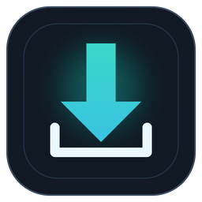

# LDownloader 🎬🎵 v2.0 PRO

**LDownloader**, Python, Tkinter ve `yt-dlp` tabanlı, koyu temalı bir Windows masaüstü video ve ses indirme uygulamasıdır. Kullanılabilir platformlar ve formatlar, kaynak içeriğe ve `yt-dlp` desteğine bağlıdır.



---

## ✨ Öne Çıkan Özellikler

### 1. 🔍 Akıllı Video Önizleme & Dinamik Çözünürlük Tespiti
* Bir video bağlantısı yapıştırıldığında arka planda video başlığı, yayıncı kanal adı, video süresi ve kapak resmi (thumbnail) otomatik olarak çekilir.
* Sabit çözünürlük tahminleri yerine, videoda **gerçekte bulunan tüm çözünürlük seçenekleri** (4K, 2K, 1080p, 720p vb.) algılanıp seçim menüsüne eklenir.

### 2. ⚡ 1-Tıkla Otomatik FFmpeg & yt-dlp Kurucusu
* Sisteminizde `ffmpeg` veya `yt-dlp` yoksa **Ayarlar** sekmesinden bunları indirebilirsiniz.
* İndirilen araçlar uygulamanın kullanıcı veri klasöründeki `bin/` dizinine kaydedilir; Windows PATH ayarını değiştirmeniz gerekmez. İndirme için internet bağlantısı gerekir.

### 3. 📦 Toplu İndirme (Batch Downloader)
* İndirmek istediğiniz birden çok video veya ses bağlantısını alt alta yapıştırın.
* Sıralı indirme kuyruğu her bir öğenin durumunu (Bekliyor / İndiriliyor / Tamamlandı / Hata) anlık olarak takip eder.

### 4. 🕒 İndirme Geçmişi & Dosya Yöneticisi
* Tekil ve toplu indirme kayıtları tarih, dosya boyutu ve format bilgisiyle yerel olarak saklanır. Oynatma listesi işlemi şu anda tek bir geçmiş kaydı oluşturur.
* 📁 **Klasörde Göster**: Windows Gezgini'ni açıp doğrudan dosyayı seçili olarak görüntüler (`explorer /select`).
* ▶ **Oynat / Aç**: Varsayılan medya oynatıcınızda videoyu veya müziği anında başlatır.

### 5. 🚀 Çok Parçalı İndirme
* İsteğe bağlı çok parçalı indirme, desteklenen akışlarda indirme hızını artırabilir. Gerçek performans ağınıza ve kaynak platforma bağlıdır; belirli bir hız artışı garanti edilmez.

### 6. 💬 Altyazı & 🖼️ Kapak Resmi Gömme
* **Altyazı Desteği**: İstenirse Türkçe ve İngilizce altyazılar indirilip, FFmpeg'in desteklediği durumlarda videoya gömülür.
* **Kapak Resmi ve Metadata**: İsteğe bağlı olarak kapak görseli ve metadata, desteklenen formatlara eklenir.

### 7. 🍪 Zen Browser & Modern Çerez (Cookies) Yönetimi
* Yaş kısıtlamalı, gizli veya YouTube 403 engeline takılan videolarda oturum çerezlerinizi tek tıkla aktarın:
  * **Desteklenen tarayıcı seçenekleri**: Zen Browser, Firefox, Chrome, Microsoft Edge, Brave, Opera, Vivaldi, Chromium. Tarayıcı sürümü, profil konumu ve işletim sistemi izinleri nedeniyle doğrudan çerez aktarımı her sistemde çalışmayabilir.
  * İsteğe bağlı manuel `cookies.txt` yükleme desteği.

### 8. 📋 Gelişmiş Playlist İndirme
* Oynatma listelerini sıralı klasör yapısıyla (`Playlist Adı / 01 - Video.mp4`) kaydeder.
* Başlangıç ve bitiş indeks aralığı belirleyebilir, hatalı/gizli videoları atlayarak indirmeye devam edebilirsiniz.

---

## 📁 Proje Mimarisi

```
LDownloader/
├── core/                       # İş mantığı ve arka plan motorları
│   ├── config.py              # Kalıcı kullanıcı ayarları (config.json)
│   ├── dependencies.py        # yt-dlp & FFmpeg algılama, 1-tıkla indirme/kurma
│   ├── downloader.py          # Asenkron indirme motoru ve süreç ağacı yönetimi
│   ├── metadata.py            # Hızlı video önizleme, thumbnail ve format ayrıştırıcı
│   ├── diagnostics.py         # Akıllı Türkçe hata teşhisi ve çözüm motoru
│   └── history.py             # İndirme geçmişi (history.json)
├── ui/                         # Arayüz bileşenleri ve modern tasarım
│   ├── theme.py               # SaaS koyu mod renk paleti ve stilleri
│   ├── components.py          # Modern kartlar, butonlar, giriş alanları, önizleme kartı
│   ├── tabs/
│   │   ├── single_tab.py      # Önizlemeli tekil indirme sekmesi
│   │   ├── playlist_tab.py    # Oynatma listesi sekmesi
│   │   ├── batch_tab.py       # Toplu indirme sekmesi
│   │   ├── history_tab.py     # İndirme geçmişi sekmesi
│   │   └── settings_tab.py    # Ayarlar, çerezler ve bağımlılık yöneticisi
│   └── app.py                 # Ana pencere ve sekme orkestrasyonu
├── ytdlp_gui.pyw              # Ana çalıştırma dosyası (Geriye dönük %100 uyumlu)
├── main.py                    # Alternatif çalıştırma noktası
├── ytdlp_indirici.spec        # PyInstaller derleme yapılandırması
├── build_exe.bat              # Tek tıkla Windows EXE derleme aracı
├── requirements.txt           # Python bağımlılıkları
├── logo.ico / logo.png        # Görsel ikonlar
└── README.md                  # Dokümantasyon
```

---

## 🚀 Kurulum ve Çalıştırma

### Gizlilik ve kullanım
* Çerezler hesabınıza erişim sağlayabilir. Yalnızca kendi hesabınızın çerezlerini kullanın; çerez dosyalarını veya uygulama tanılama kayıtlarını başkalarıyla paylaşmayın.
* İndirilen içerikleri kullanırken ilgili platformların hizmet koşullarına, içerik sahiplerinin haklarına ve yerel mevzuata uyun. Uygulama, bir içeriği indirme veya yeniden kullanma hakkı vermez.
* Harici araçlar ve medya içeriği internetten indirilir. İndirme ve kurulum işlemleri güvenilir bir ağ üzerinden yapılmalıdır.

### 1. Gereksinimleri Yükleyin:
```bash
pip install -r requirements.txt
```

### 2. Uygulamayı Başlatın:
```bash
python ytdlp_gui.pyw
```
*(veya `python main.py`)*

---

## 🛠️ Tek Tıkla EXE Olarak Derleme

Uygulamayı tek bir Windows `.exe` dosyası haline getirmek için:
* `build_exe.bat` dosyasına çift tıklayın veya terminalden çalıştırın:
```bash
pyinstaller --noconfirm ytdlp_indirici.spec
```
Oluşturulan taşınabilir dosya `dist/LDownloader.exe` konumunda yer alacaktır.

---

## 📝 Lisans ve Katkı

Bu proje açık kaynaklıdır. Hata bildirimleri veya yeni özellik önerileri için Pull Request gönderebilir veya Issue oluşturabilirsiniz.

İyi indirmeler! 🚀
